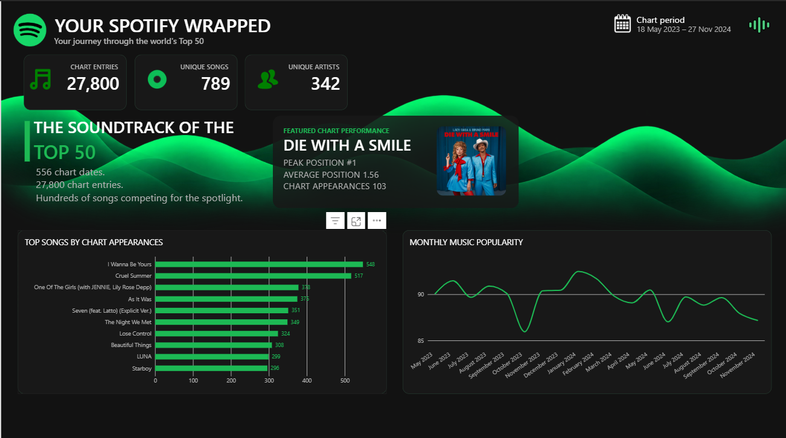
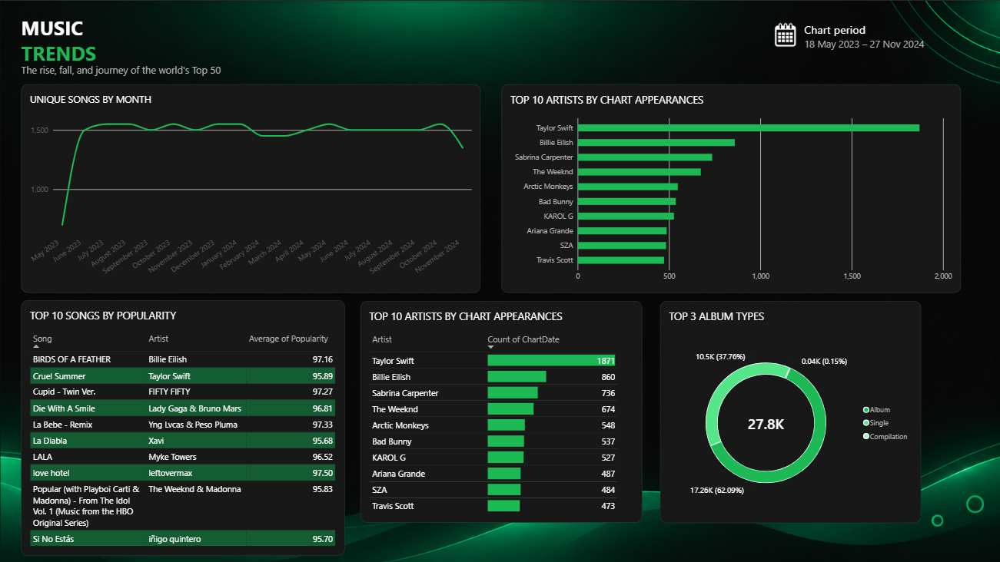
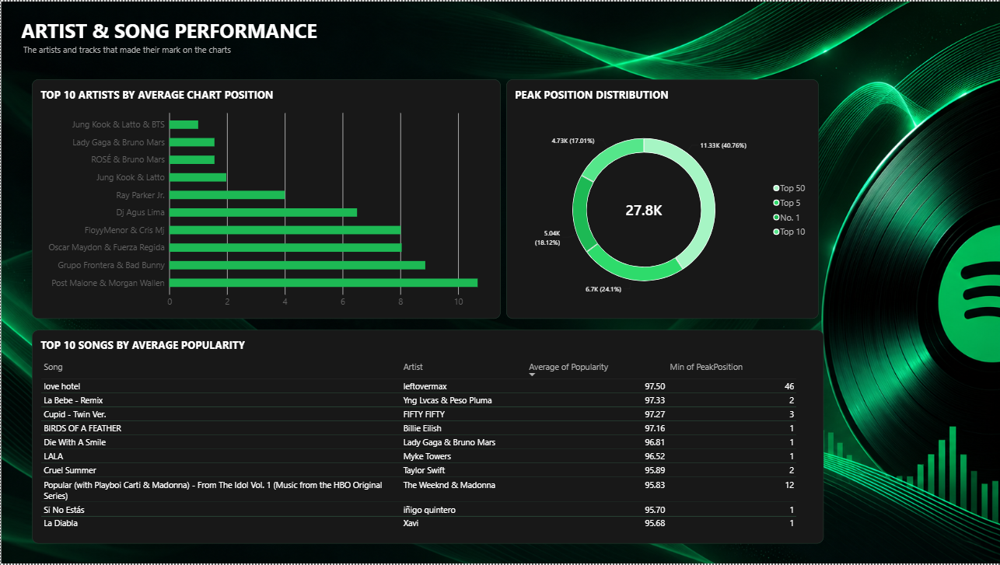

# Spotify Wrapped Analytics

An end-to-end music chart analytics project built using **Python, Pandas, SQL Server, and Power BI**. This project transforms public Spotify Top 50 chart data into an interactive, Spotify-inspired dashboard that explores song popularity, artist performance, and chart-position trends.

## Project Overview

This project analyzes daily Top 50 music chart data to understand which songs and artists consistently perform well, how chart popularity changes over time, and how chart positions are distributed.

The project follows a data analytics workflow from raw CSV data through Python data preparation and SQL Server storage to interactive Power BI visualizations.

> **Note:** This project analyzes public chart data; it is not based on an individual's personal Spotify listening history.

## Tools & Technologies

- **Python:** data inspection and cleaning
- **Pandas:** data manipulation and transformation
- **SQL Server:** structured data storage, analytical queries, and validation
- **Power BI:** interactive dashboards and visual analytics
- **DAX:** measures and calculated fields
- **Git & GitHub:** project version control and documentation

## Data Overview

The dataset contains daily global Top 50 chart records.

| Attribute | Details |
|---|---|
| Source format | CSV |
| Chart records | 27,800 |
| Chart dates | 556 |
| Entries per chart date | 50 |
| Chart date range | 18 May 2023 – 27 November 2024 |

The dataset includes fields such as chart date, position, song, artist, popularity, duration, album type, release date, explicit-content status, and album cover URL.

## Project Workflow

### Python Data Cleaning and Feature Engineering

The `python/python02_cleaning.py` script prepares the raw Spotify chart data for downstream SQL analysis and Power BI reporting.

- Loads the raw CSV from `raw/spotify-top-50-world.csv` and writes the processed dataset to `processed/spotify_top50_clean.csv` using project-relative paths.
- Converts chart dates and song release dates into datetime formats.
- Adds date-analysis fields: release year, chart year, chart month, month name, and month-year label.
- Calculates song-level metrics: distinct days on chart, average chart position, peak position, and total chart appearances.
- Calculates artist-level metrics: total chart appearances and average chart position.
- Creates an `is_top_10` flag for records with a chart position of 10 or better.
- Saves the enriched dataset without writing the DataFrame index and prints row counts, column names, output path, and completion status for validation.

The script enriches each chart record with analysis-ready features; it does not aggregate the dataset to one row per song or artist.

### Python Data Inspection

The `python/python01_inspection.py` script performs an initial inspection of the raw Spotify chart dataset using Python and Pandas.

- Loads the raw CSV file from the project's `raw/` directory using a project-relative path.
- Converts chart dates and song release dates into datetime formats.
- Checks chart-date continuity by identifying the smallest and largest gaps between consecutive chart dates.
- Validates chart positions by checking the number of unique positions recorded for each date.
- Reports dates with fewer than 50 unique chart positions.

The script prints its validation results to the console and does not modify the source dataset.

1. **Data inspection:** examined the raw dataset, column types, date coverage, missing values, duplicates, and chart-position consistency.
2. **Data cleaning:** used Python and Pandas to standardize date fields, prepare analytical columns, and export the cleaned dataset.
3. **SQL data modeling:** loaded the prepared data into SQL Server and organized it for analysis using a date dimension and chart fact table.
4. **Data validation:** checked record counts, distinct songs and artists, blank values, and other data-quality conditions.
5. **Power BI development:** connected the warehouse to Power BI, created analytical visuals, and applied a dark Spotify-inspired design.

## Dashboard Pages

### 1. Spotify Wrapped

An overview of the dataset and key chart insights, presented in a Spotify-inspired summary layout.

### 2. Music Trends

Explores unique songs by month, artists with the most chart appearances, song popularity, and album-type distribution.

### 3. Artist & Song Performance

Examines artist rankings by average chart position, peak-position distribution, and the top 10 songs by average popularity.

## Dashboard Preview

### Page 1 — Spotify Wrapped



### Page 2 — Music Trends



### Page 3 — Artist & Song Performance



## Key Analytical Areas

- Song popularity comparisons
- Artist chart appearances and performance
- Monthly chart trends
- Peak chart-position distribution
- Album-type distribution
- Data quality and SQL validation

## Repository Structure

```text
Spotify-Wrapped-Analytics/
├── raw/
│   └── spotify-top-50-world.csv
├── processed/
│   └── spotify_top50_clean.csv
├── python/
│   ├── python01_inspection.py
│   └── python02_cleaning.py
├── sql/
│   ├── 01_inspect_table_schema.sql
│   ├── 02_data_quality_validation.sql
│   ├── 03_song_artist_analysis.sql
│   └── 04_album_and_chart_performance.sql
├── powerbi/
│   ├── Icons/
│   └── Spotify_Wrapped_Analytics.pbix
└── screenshots/
    ├── page1_spotify_wrapped.png
    ├── page2_music_trends.png
    └── page3_artist_song_performance.png
```

## How to Explore the Project

1. Review the Python scripts to understand the inspection and cleaning process.
2. Open the SQL scripts to explore data modeling, validation, and analytical queries.
3. Open the Power BI report to explore the three dashboard pages.
4. Review the dashboard screenshots in the `screenshots/` directory.

## Skills Demonstrated

- Data profiling and quality checks
- Python data cleaning with Pandas
- SQL querying and data validation
- Dimensional data modeling
- Power BI dashboard development
- DAX and data visualization
- End-to-end analytics project development

## Project Goal

To demonstrate an end-to-end data analytics workflow by transforming raw music chart data into a validated analytical dataset and an interactive dashboard.

---

*This is an independent analytics project using public chart data and is not affiliated with Spotify.*